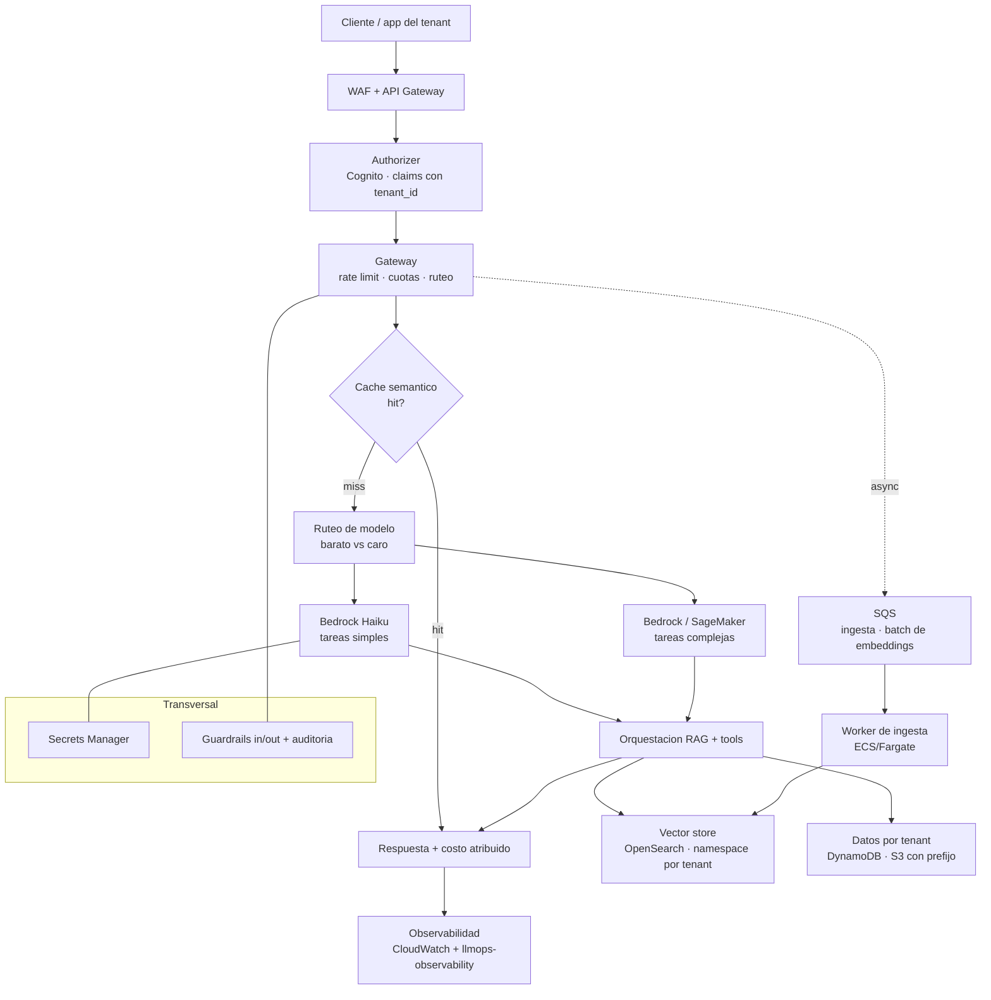

# Arquitectura — plataforma GenAI multi-tenant en AWS

Documento principal de arquitectura. Describe cómo se sirve un sistema GenAI
(RAG + tools) a múltiples clientes (tenants) de forma escalable, segura y con
costos bajo control. El proveedor elegido es **AWS** (ver `adr/0001`).

## Diagrama de la plataforma

## Cómo responde la arquitectura a las cinco preguntas

### Escalabilidad
La capa de aplicación (gateway + orquestación) es **stateless** y corre en
ECS/Fargate o Lambda con autoscaling por CPU/concurrencia. Las cargas pesadas
(ingesta de documentos, batch de embeddings) se sacan del camino síncrono con
**SQS** y un worker que escala por profundidad de cola. La inferencia gestionada
(Bedrock) absorbe picos sin administrar GPUs; para modelos propios, SageMaker con
autoscaling de endpoints. Trade-off: serverless (Lambda) simplifica ops pero tiene
cold starts y límite de payload; ECS/Fargate da más control a cambio de más
gestión. Ver `adr/0002`.

### Multi-tenancy
Cada request llega con un `tenant_id` en los claims del token (Cognito). El
gateway aplica **rate limiting y cuotas por tenant**, y toda la data se
particiona por tenant: namespace en el vector store, partition key en DynamoDB,
prefijo en S3. El aislamiento es **lógico** (pool compartido) por costo/eficiencia,
con opción de **silo** (recursos dedicados) para tenants premium. Ver `multi-tenancy.md`
y `adr/0003`.

### Seguridad
Autenticación con Cognito, autorización por tenant en el gateway, secretos en
**Secrets Manager** (nunca en código), red privada con VPC + PrivateLink para no
exponer la inferencia a Internet, y WAF en el ingreso. Contra **prompt injection**:
guardrails de entrada/salida (Bedrock Guardrails o propios), y las tools se
ejecutan con permisos mínimos por tenant.

### Costos
Tres palancas: **caching semántico** (respuestas repetidas no pagan inferencia),
**ruteo de modelos** (un modelo barato resuelve las tareas simples; el caro solo
cuando hace falta), y **atribución de costo por tenant** (tokens × precio,
etiquetado con `tenant_id`, exportado a la capa de observabilidad). Ver `adr/0002`.

### Gobernanza
Versionado de prompts y modelos (un cambio de prompt es un deploy trazable),
guardrails aplicados de forma consistente en el gateway, y auditoría: cada request
deja traza con `request_id`, `tenant_id`, modelo, tokens y costo.

## Flujo de un request (camino feliz)

1. El cliente llama al API Gateway (detrás de WAF) con su token.
2. El authorizer valida el token y extrae `tenant_id`.
3. El gateway chequea rate limit/cuota del tenant.
4. Busca en el **cache semántico**; si hay hit, responde sin inferir.
5. Si no, **rutea** el modelo (barato vs caro) según complejidad.
6. Orquesta RAG (recupera del vector store con el namespace del tenant) e invoca el modelo.
7. Guarda en cache, atribuye el costo y responde; emite métricas a observabilidad.

La `reference-impl/gateway/` implementa y testea los pasos 2–5 y 7 (auth, rate
limit, cache, ruteo, atribución) sobre una inferencia mock, para demostrar que el
diseño es realizable. La `reference-impl/infra/` trae el esqueleto Terraform del
subconjunto desplegable.
